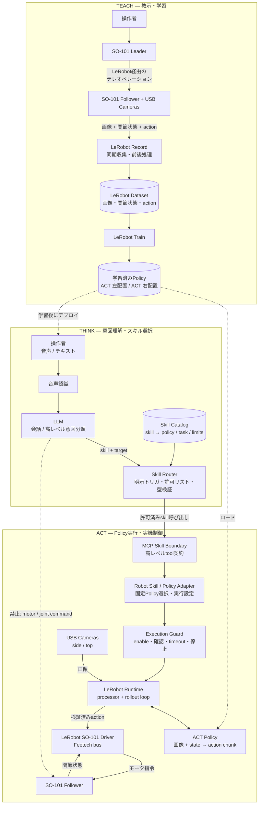
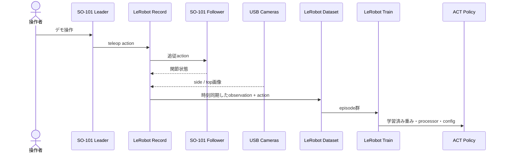
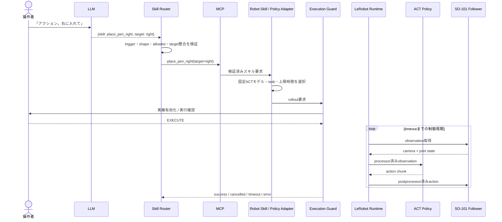
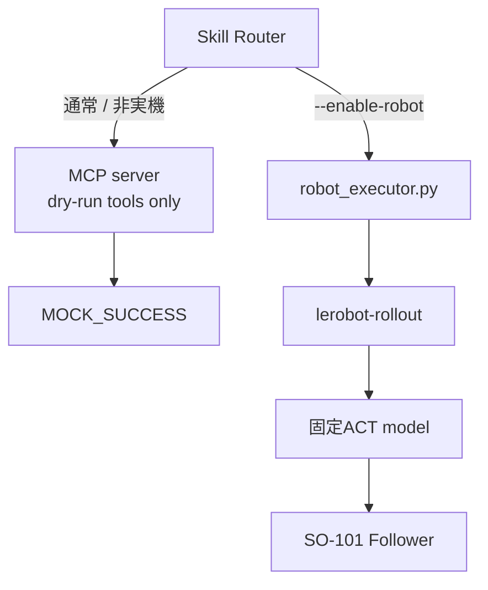

# OSC2026 Physical AI — Teach → Think → Act アーキテクチャ

Three Up Automata / OSC2026 Physical AI プロジェクトにおける、SO-101を使った模倣学習デモのシステム構成を示す。本書は現在のリポジトリを基準にした設計資料であり、実装の変更は含まない。

## 1. 設計原則

- LLMは自然言語の解釈と、登録済みRobot Skillの選択だけを担当する。
- LLMが関節角、モータ指令、rollout引数を生成することは禁止する。
- Skill Routerは許可リスト、引数スキーマ、実行条件を検証する。
- Robot Skill / Policy Adapterは、意味的なスキル名を固定済みのPolicy、task、実行上限へ変換する。
- ACTなどのPolicyが、カメラ画像と関節状態から低レベルのaction chunkを推論する。
- LeRobotがデータ記録、学習、Policyロード、前後処理、制御ループ、SO-101ドライバを提供する。
- MCPは高レベルのスキル境界、ROS 2はロボット実行基盤との通信境界として扱う。どちらもLLMからモータへの迂回路にはしない。
- タイムアウト、明示的な実機有効化、必要に応じた人手確認、停止手段を実行経路に置く。

## 2. システム全体像

上図は現在の実装に合わせ、LeRobot RuntimeからSO-101 Driverを直接呼び出す構成としている。ROS 2は未実装の将来候補であるため、この図には含めない。

## 3. 責務と境界

| コンポーネント | 入力 | 出力 | 責務 | 非責務 |
|---|---|---|---|---|
| LLM | 発話テキスト、登録スキルの説明 | 高レベルの `skill` と意味的引数 | 会話、意図分類 | Policyパス、秒数、関節値、モータ値の生成 |
| Skill Router | LLMの構造化出力 | 検証済みスキル要求 | 明示的なアクショントリガ、許可リスト、スキーマ照合 | ロボット制御、Policy推論 |
| MCP | tool名と高レベル引数 | tool結果 | スキル契約、発見、プロセス間境界、監査可能な呼び出し | リアルタイム関節制御 |
| Robot Skill / Policy Adapter | 検証済みスキル要求 | 固定されたrollout設定 | `skill → model + task + limits` の決定、Policy差し替え吸収 | 自由形式のLLM出力を実行設定へ流用 |
| ACT Policy | 正規化済み画像・関節状態 | action chunk | 教示データに基づく低レベル動作生成 | 自然言語の自由解釈、スキル選択 |
| LeRobot | robot observation、dataset、policy | 前後処理済みaction、ドライバ呼び出し | 記録、学習、Policyロード、processor、rollout、hardware abstraction | 高レベル業務オーケストレーション |
| ROS 2 Adapter | LeRobot側の観測／action | topic、service、action | ノード分離、他センサ統合、監視、ライフサイクル管理 | LLM出力の安全性判断、Policyそのもの |
| SO-101 Follower | 制限済みモータ指令 | 動作、関節状態 | 物理動作 | 意図判断 |

MCPとROS 2は競合する選択肢ではない。MCPはLLM側の低頻度な高レベルtool呼び出し、ROS 2はロボット側の決定論的な通信・実行統合に使う。カメラ／関節状態／actionのフレーム単位ストリーミングをMCPへ載せない。

## 4. Teachフロー

現在の右配置モデルは、`side`／`top`画像 `(3, 480, 640)` と6次元の `observation.state` を入力し、6次元の `action` を出力するACTである。モデルカード上の学習データは20 episode、11,851 frames、20 FPSで、action chunkは100 stepに設定されている。左配置についても対応する専用モデルが置かれている。

## 5. Think → Act 実行フロー

LLMの返答は、Routerで検証に成功した `skill` と `target` 以外は実行経路へ入らない。モデルパス、task文、カメラ割り当て、rollout時間、デバイス、ロボットポートはAdapter側の信頼済み設定として保持する。

## 6. 現在のリポジトリへの対応

| 設計要素 | 現在の実体 | 状態 |
|---|---|---|
| Skill Router | `examples/so101/voice_skill_router/router.py` | 実装済み。先頭の「アクション」だけを実行系へ通し、skill／targetを厳密検証 |
| LLM Adapter | `examples/so101/voice_skill_router/openai_client.py` | 実装済み。会話、文字起こし、意図分類を担当 |
| MCP境界 | `mcp_client.py`, `mcp_server.py` | dry-runのみ。左右のペン配置toolを公開 |
| Robot Skill / Policy Adapter | `robot_executor.py` の `SKILL_CONFIG` と `build_rollout_command` | 実装済み。左右skillを固定ローカルACTモデルへ対応付け |
| 実行ガード | `cli.py`, `robot_executor.py` | `--enable-robot`、既定の `EXECUTE` 確認、最大30秒 |
| LeRobot Runtime | `lerobot-rollout`、processor、policy factory、SO follower driver | 実装済み |
| ACTモデル | `models/act_so101_pen_center_{left,right}_20ep_v3/` | 学習済みモデルを配置済み |
| Teachデータ | `datasets/so101_pen_*` | ローカルdatasetを配置済み |
| ROS 2 | 該当実装なし | 将来候補。現状の実機経路には不要 |

### 現行実行経路

現状はモードによって経路が異なる。

つまり、MCPが現時点で実機の制御面に入っているわけではない。目標構成でMCPを実機スキル境界にする場合も、MCP toolは `place_pen_right` のような高レベル操作だけを公開し、内部で同じAdapterとExecution Guardを必ず通す。

## 7. 推奨デプロイ構成

Ubuntu mini PC上で、次のプロセス境界を推奨する。

1. **Interaction process** — マイク入力、STT、LLM、音声応答。
2. **Skill service** — Skill Router、MCP server、Skill Catalog、監査ログ。LLMから隔離した許可リストを所有する。
3. **Robot runtime** — Robot Skill / Policy Adapter、Execution Guard、LeRobot Runtime、ACTモデル。実機デバイスへの権限はこのプロセスだけに与える。
4. **ROS 2 graph（必要になった段階）** — 複数ノード、追加センサ、可視化、遠隔監視、ライフサイクル制御が必要な場合にRobot runtimeの内側へ導入する。

展示の最小構成では、ROS 2を先に必須化せず、既存LeRobot直結経路を維持する方が単純である。ROS 2を導入しても、Policy推論周期とmotor safetyはRobot runtime側に閉じ、LLM／MCP側からROS 2 topicへ直接publishできない権限設計にする。

## 8. 安全性と運用上の要件

- 実機プロセスはデフォルト無効とし、起動時に明示的に有効化する。
- 展示中は各スキルの最大実行時間、関節範囲、速度／トルク上限、watchdogを適用する。
- ソフトウェアのCtrl+Cだけに依存せず、電源遮断を含む物理的な非常停止手段を用意する。
- Policyが学習したカメラ名、解像度、視点と、実機の `side`／`top` 割り当てを起動前に検証する。
- Policy推論が目標制御周期に届かない場合、FPS値を下げるだけで解決したと見なさず、実測レイテンシとaction cadenceを評価する。
- スキル開始・終了・取消・timeout・例外、選択Policyの識別子、人手確認結果を記録する。画像や音声の保存は展示時のプライバシーポリシーに従う。
- 未知のskill、余分な引数、target不一致、Policy／観測feature不一致はfail closedで拒否する。

## 9. 実装へ進む場合の段階案

1. 現行の直結構成で、左右ACTスキルの成功率、停止手順、CPU推論周期を計測する。
2. `SKILL_CONFIG`を型付きSkill Catalogへ分離し、Policy feature互換性とhardware profileを起動前検証する。
3. MCPの実機toolをRobot runtimeへの高レベル要求として追加し、dry-runと実機を同じAdapter／Guardへ収束させる。
4. 複数ノード化や外部監視が必要になった時点でROS 2 Adapterを追加する。
5. 会場運用向けに物理E-stop、watchdog、監査ログ、復旧runbookを完成させる。

この順序なら、LLMと物理制御の安全境界を維持したまま、現在動作しているLeRobot＋ACT構成から段階的に拡張できる。
