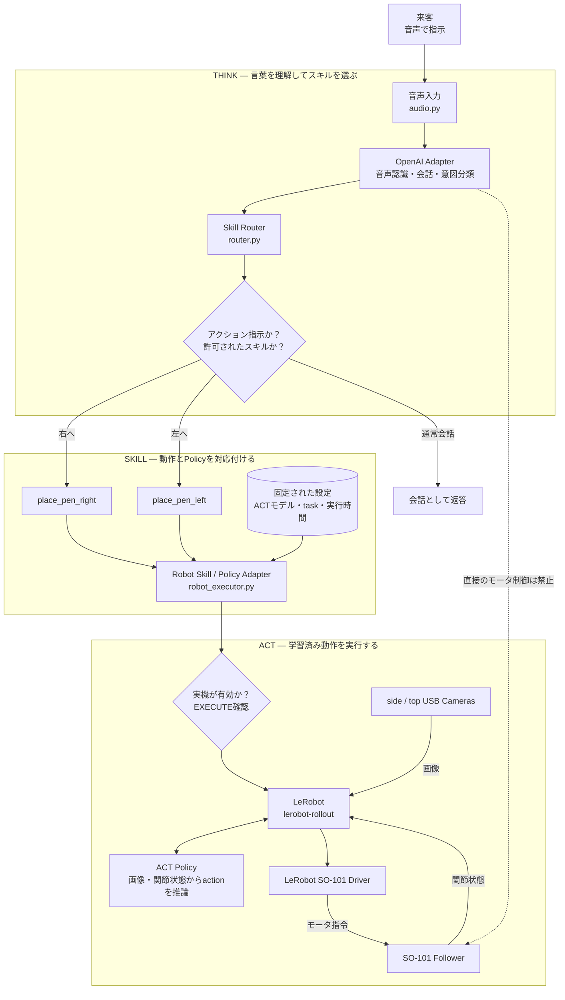
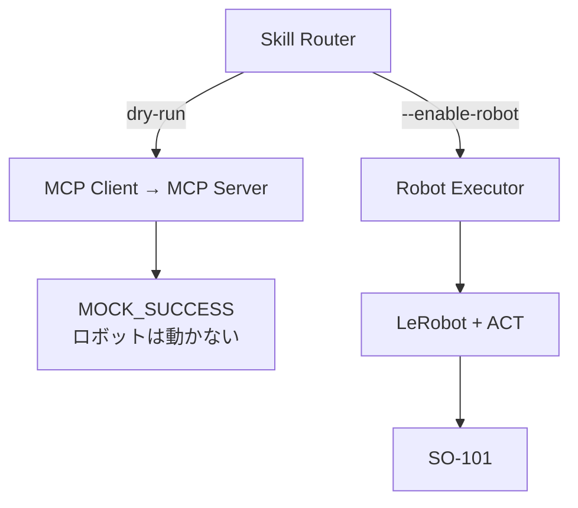

来客には、まず「LLMがロボットを直接動かしているのではなく、LLMは登録済みの動作を選ぶだけ」と説明すると、全体像が伝わりやすいです。

## 全体像



## 自分の言葉で説明するなら

次の順序で話すと自然です。

### 1. 「まず、人の言葉を理解します」

来客が、

> アクション。右に入れて

と話すと、マイクで音声を録音し、OpenAIのサービスを使って文字に変換します。

ただし、どんな発話でもロボットが動くわけではありません。先頭に「アクション」と付いた発話だけが、ロボット操作の候補になります。

この入口を担当するのが、[router.py](/home/mikami/lerobot-v060/examples/so101/voice_skill_router/router.py)のSkill Routerです。

### 2. 「LLMは動作を作らず、登録済みスキルを選びます」

LLMが行うのは、発話を次のような高レベルの指示に分類することです。

```text
skill: place_pen_right
target: right
```

現在選択できるロボットスキルは、基本的に次の2つです。

- `place_pen_right`：ペンを右側へ入れる
- `place_pen_left`：ペンを左側へ入れる

それ以外のスキル名や、`place_pen_right`なのに`target=left`となっている不整合な指示は拒否されます。

ここで重要なのは、LLMが次の情報を作らないことです。

- モータの角度
- 関節の軌道
- Policyのファイルパス
- カメラやシリアルポートの設定
- ロボットを動かす秒数

つまり、LLMは「右のスキルを使う」という意思決定までです。

### 3. 「選ばれたスキルを、専用のACTモデルに結び付けます」

[robot_executor.py](/home/mikami/lerobot-v060/examples/so101/voice_skill_router/robot_executor.py)には、スキルとACTモデルの対応が固定設定されています。

```text
place_pen_right
    → 右配置用ACTモデル
    → 「中央のペンを右のホルダーへ入れる」

place_pen_left
    → 左配置用ACTモデル
    → 「中央のペンを左のホルダーへ入れる」
```

この部分がRobot Skill / Policy Adapterです。

LLMがモデルを自由に選ぶのではなく、システム側で事前に確認した組み合わせだけを使います。

### 4. 「実機を動かす前に、安全確認を通します」

ロボットはデフォルトでは無効です。実機を動かすには、起動時に`--enable-robot`を明示する必要があります。

通常は、スキルを実行する直前にも、

```text
Type EXECUTE to confirm:
```

という確認が表示されます。

さらに、1回の動作は最大30秒に制限されています。デモの既定値は5秒です。

この部分は、安全装置そのものではありませんが、誤認識した音声から即座にロボットが動くのを防ぐExecution Guardです。

### 5. 「実際の細かい動作はACTとLeRobotが担当します」

スキルが確定すると、LeRobotの`lerobot-rollout`が起動します。

ACT Policyには、毎回次の情報が入力されます。

- sideカメラの画像
- topカメラの画像
- SO-101の6つの関節状態

ACTは教示データから学習した結果を使い、6次元のactionを出力します。LeRobotがそのactionを前後処理して、SO-101のドライバへ渡します。

したがって、物理的な制御経路は次のようになります。

```text
USBカメラ・関節状態
    ↓
LeRobot
    ↓
ACT Policy
    ↓
LeRobotのaction処理
    ↓
SO-101 Driver
    ↓
モータ
```

ここにはLLMは入っていません。

## ファイルごとの役割

| ファイル | ひと言で説明すると |
|---|---|
| [cli.py](/home/mikami/lerobot-v060/examples/so101/voice_skill_router/cli.py) | 全体を起動し、音声入力・モード・実行確認を管理する司令塔 |
| [audio.py](/home/mikami/lerobot-v060/examples/so101/voice_skill_router/audio.py) | USBマイクから音声を録音する |
| [openai_client.py](/home/mikami/lerobot-v060/examples/so101/voice_skill_router/openai_client.py) | 音声認識、通常会話、アクション分類、音声合成を担当する |
| [router.py](/home/mikami/lerobot-v060/examples/so101/voice_skill_router/router.py) | 「アクション」判定と、許可されたskill／targetの検証を行う |
| [robot_executor.py](/home/mikami/lerobot-v060/examples/so101/voice_skill_router/robot_executor.py) | スキルを固定ACTモデルへ変換し、安全確認後にLeRobotを起動する |
| [mcp_client.py](/home/mikami/lerobot-v060/examples/so101/voice_skill_router/mcp_client.py) | dry-run用MCPサーバーを呼び出す |
| [mcp_server.py](/home/mikami/lerobot-v060/examples/so101/voice_skill_router/mcp_server.py) | dry-runの左右スキルをMCP toolとして公開する |
| [mock_client.py](/home/mikami/lerobot-v060/examples/so101/voice_skill_router/mock_client.py) | APIや実機なしでルーティングを試すためのモック |

## MCPについての正確な説明

現在のMCPは、実機を動かすための経路ではなく、dry-run用です。



そのため、来客には次のように説明できます。

> MCPでロボットスキルをtoolとして扱う実験もしています。ただし、現在の実機デモは安全性と単純さを優先して、検証済みのRobot ExecutorからLeRobotを起動しています。MCP側はまだdry-runです。

## 30秒で説明する場合

> このシステムは、音声からロボットのスキルを選ぶ部分と、実際にロボットを動かす部分を分離しています。LLMは「右へ入れる」「左へ入れる」という登録済みスキルを選ぶだけで、モータを直接制御しません。選択されたスキルには、あらかじめ専用のACTモデルが割り当てられています。実際の画像認識と関節動作はACTとLeRobotが担当し、確認操作と時間制限を通してからSO-101を動かします。

## 一番伝えたいポイント

来客に覚えてもらいたいのは、この三段階です。

> **Teach**：人がLeaderアームで動作を教える。  
> **Think**：LLMが言葉を理解して、登録済みスキルを選ぶ。  
> **Act**：ACTとLeRobotが、カメラを見ながらSO-101を動かす。

そして安全設計の要点は、

> **LLMは「何をするか」を選び、ACTとLeRobotが「どう動くか」を担当する。**

です。